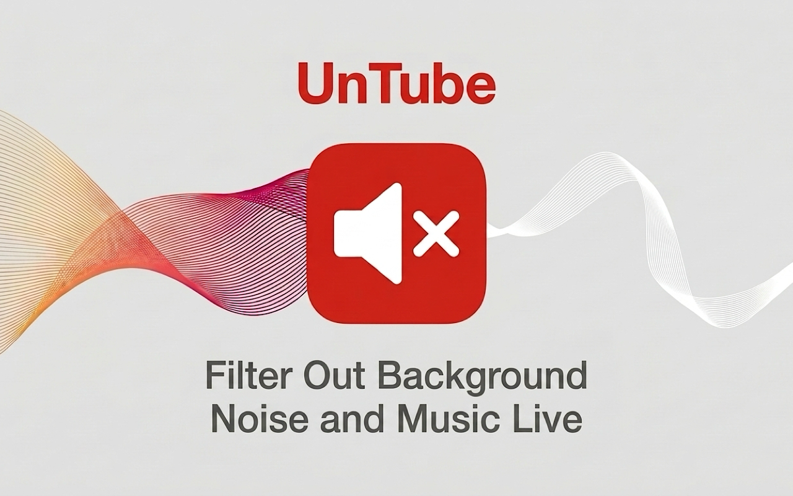

# UnTube

Real-time neural speech isolation extension for Chromium browsers that filters out background noise and music live using a custom-trained version of FastEnhancer-M running on WebAssembly SIMD.

---

## Key Features

* **Custom Trained Model:** Runs a custom-trained version of FastEnhancer-M (`assets/fastenhancer_m.onnx`, 2.4 MB), optimized specifically for background music and accompaniment attenuation while preserving clean speech.
* **Client-Side Inference:** Executes locally via WebAssembly SIMD using ONNX Runtime. Audio stays on the local device.
* **Tab Audio Capture:** Captures tab audio via `chrome.tabCapture` across media players, embedded players, and cross-origin iframes.
* **Low Latency & Zero Idle Overhead:** Average inference step runs in ~1.15 ms per 6.67 ms hop (~17% real-time budget). During speech pauses, inference auto-sleeps at 0% CPU, and toggling off closes the offscreen document and terminates the worker, releasing all CPU threads and memory.

---

## Audio Pipeline

1. **Capture:** 48 kHz stereo stream acquired via `chrome.tabCapture.getMediaStreamId()`.
2. **Buffer Bridge:** Bridges WebAudio's 128-sample quanta to the neural network's 320-sample hops using a circular ring buffer.
3. **Inference:** Background Web Worker running a custom-trained FastEnhancer-M (`assets/fastenhancer_m.onnx`, 2.4 MB) over a transferable `MessagePort`.
4. **Post-Processing:**
   * Soft expander reduces residual background bleed during speech pauses.
   * 4-pole Butterworth low-pass filter attenuates quantization noise above 9.5 kHz.
   * Peak limiter prevents inter-sample clipping on sudden vocal transients.

---

## Model Details

UnTube runs a custom causal recurrent neural network based on FastEnhancer-M (`assets/fastenhancer_m.onnx`, 2.4 MB), trained specifically for music and accompaniment attenuation.

* **Architecture:** Causal 1D convolutional encoder/decoder with recurrent GRU state memory.
* **Frame Dynamics:** 320-sample hops (6.67 ms at 48 kHz). Algorithmic latency is strictly causal with zero lookahead.
* **Metrics:**
  * Music attenuation: 24.3 dB SDR improvement over mixture input.
  * Speech retention: +0.19 dB passthrough across vocal formants with zero onset degradation.
  * Compute latency: ~1.15 ms per hop on modern x86-64 / Apple Silicon CPUs (~17% real-time budget utilization).

---

## Installation

**Note:** Requires desktop Chromium (like Chrome, Edge, and Opera). Audio manipulation is not supported on mobile browsers.

### Option 1: Chrome Web Store

<a href="https://chromewebstore.google.com/detail/dnpjndgmbnibmfemfmbkbkpgkflcmgdp">
  
</a>

Install directly from the [Chrome Web Store](https://chromewebstore.google.com/detail/dnpjndgmbnibmfemfmbkbkpgkflcmgdp).

### Option 2: Install from Source

1. Clone or download this repository.
2. Open your browser's extensions page (e.g. `chrome://extensions`).
3. Enable **Developer mode** in the upper-right corner.
4. Click **Load unpacked** and select the repository directory.
5. Pin **UnTube** to the browser toolbar.

---

## Controls

Click the toolbar icon or press `Command+Shift+U` (macOS) / `Alt+Shift+U` (Windows/Linux) to toggle speech isolation on the active tab.

The toolbar icon indicates extension status: **Grey** (inactive / standby), **Amber** (initializing audio pipeline, ~150 ms), or **Red** (active speech isolation).

When toggled off, or when the captured tab closes, all audio tracks are released and the background offscreen document is closed.

---

## Project Structure

```
├── manifest.json          # Extension manifest (Manifest V3)
├── background.js          # Service worker & tab capture controller
├── content.js             # Fullscreen helper bridge
├── logger.js              # Logging utility
├── offscreen.html         # Offscreen document host
├── offscreen.js           # WebAudio audio graph
├── ring-buffer-worklet.js # Circular ring buffer AudioWorklet
├── inference-worker.js    # ONNX Runtime WebAssembly worker
├── assets/                # Neural model weights and WebAssembly runtime
├── icons/                 # Extension status icons
├── PRIVACY.md             # Privacy policy
└── README.md              # Documentation
```

---

## Privacy

UnTube executes entirely client-side on your local machine. Audio is processed in memory and is never recorded, written to disk, or sent to external servers. The extension operates with no backend servers, cloud APIs, telemetry, or user tracking.

---

## Attribution

If you use, fork, or adapt this code or design, please properly attribute and link back to the original [UnTube repository](https://github.com/reedwan/UnTube).

This project uses the [FastEnhancer](https://github.com/aask1357/fastenhancer) model architecture and [ONNX Runtime Web](https://github.com/microsoft/onnxruntime) (both MIT licensed).

